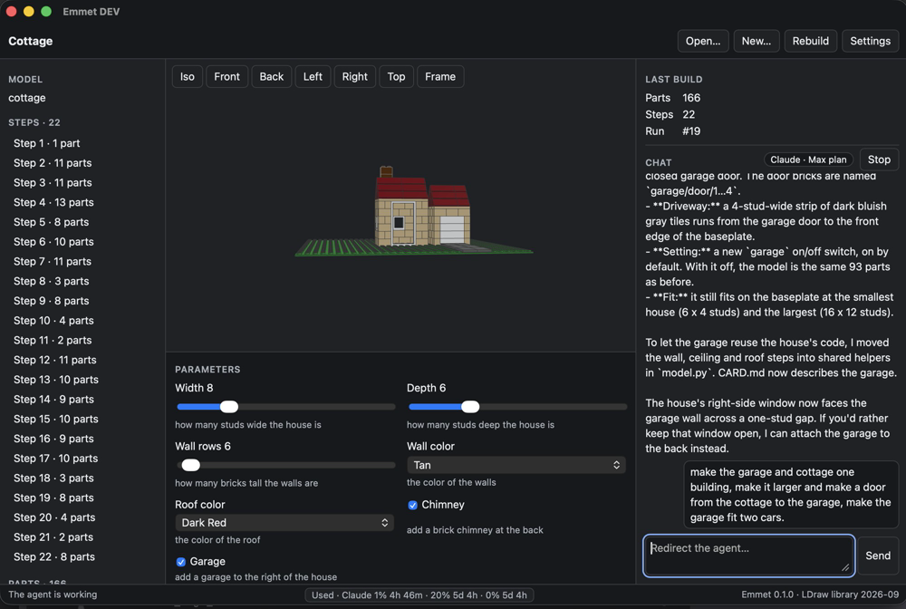
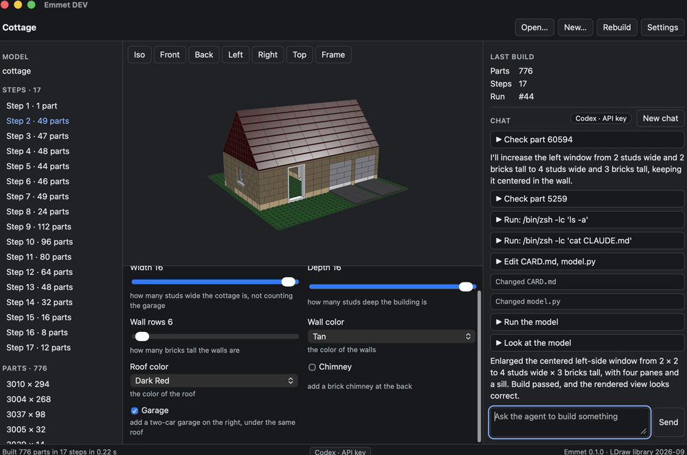
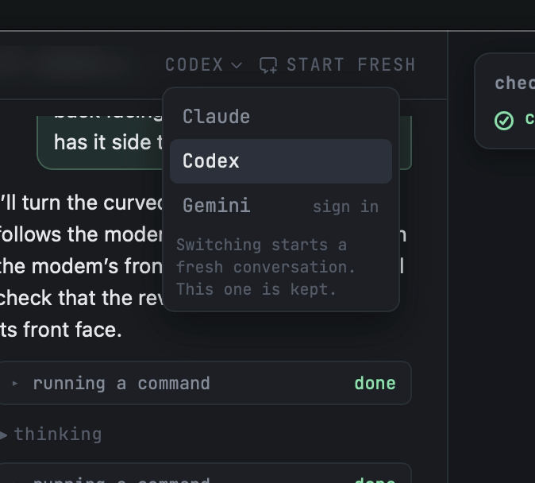
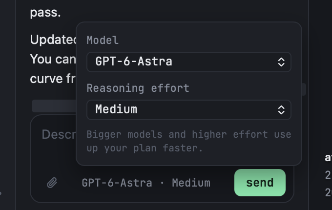

# Design and feature notes

Barry's notes from using Emmet, newest first. 2A reads this file before it starts, and each direction answers every
layout note. Each note says which session builds it. Add new notes at the top with the date.

## 2026-10-25, from the 1C live check

Barry used 1C's plain chat pane on the cottage, with Claude Code on his Max plan and Codex on an API key.

| Emmet after 1C, with Claude | Emmet after 1C, with Codex |
|---|---|
|  |  |

### Layout and design (2A designs them; the session named builds them)

1. **Show what the agent is doing, in context.** The status about the agent working belongs above the chat, where
   the user is looking, with a spinner, so it's clear the agent is still working. The chat sometimes looked stalled.
   1C pinned an "agent is working" line with a spinner and a seconds counter above the composer. 2A decides its
   final place and look; 4B builds it.
2. **Less code in the chat.** The chat showed too much code. 4B's plain-language tool cards, with the raw input and
   output collapsed, are the answer; 2A should show how little code each direction needs by default.
3. **Agent switching and Start fresh, like nurb.** nurb's chat header has the agent picker and a Start fresh button.
   Switching agents starts a fresh conversation and keeps the old one, and Start fresh clears the context without
   switching. nurb's picker also offers Gemini, with a "sign in" link when it isn't set up (D-42). 4B builds it.

   

4. **A model and effort picker, like nurb.** nurb's composer has Model and Reasoning effort, notes that "Bigger
   models and higher effort use up your plan faster", and shows the choice next to Send. 4B builds it (D-41's note
   on small plans).

   

5. **How useful are the sliders?** Barry questions the sliders as they stand (width, depth, wall rows, colors,
   chimney, garage). 2A looks at what nurb's sliders do well and proposes which parameters show, how they're grouped
   and labeled, and how they read in each direction. 3B owns which parameters the templates expose.
6. **A step shows the build up to that step.** Clicking a step should show the model built up to it and hide the
   bricks of later steps. Today clicking a step highlights it but shows the whole model. Section 13's step scrubber
   now says later steps are hidden, and 4C builds it, from the steps list as well as the scrubber.

### Features (homes approved by Barry, 2026-10-25)

7. **A default Emmet folder for new projects, which the user can change.** 4A: New saves to `Documents/Emmet` by
   default, and Settings changes the folder.
8. **The baseplate as an option.** A baseplate of about 30 × 30 studs by default, which the user can turn off. The
   cottage already stands on the standard 32 × 32 baseplate (part 3811), the closest real size. 3B: every template
   gets a baseplate on/off parameter; with it off, the model starts at the ground instead of on the plate.
