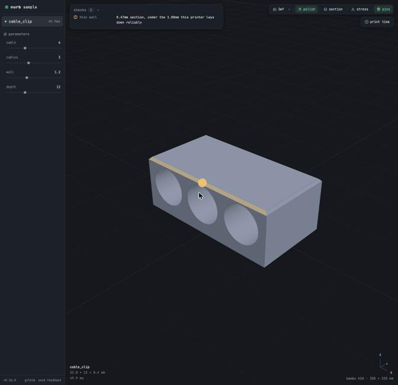
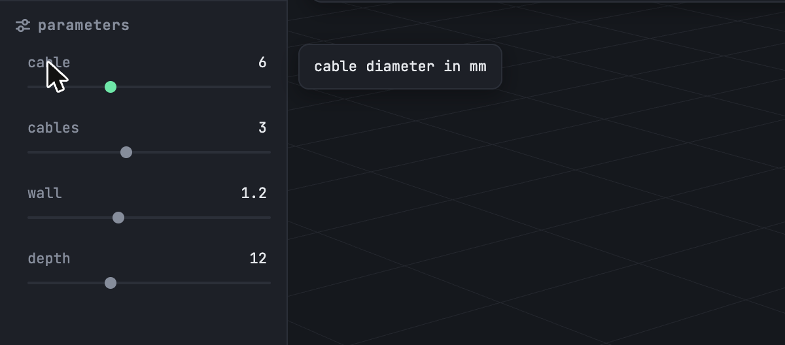
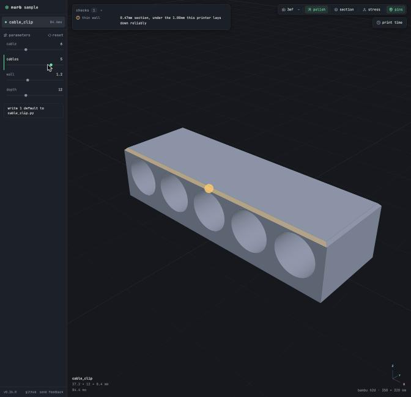
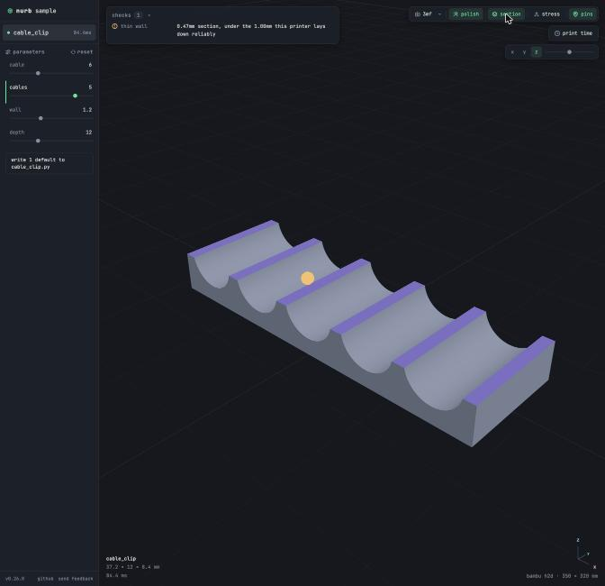
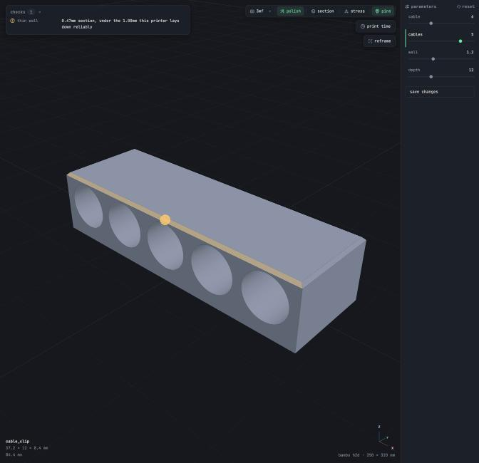

# Design research (2A)

What nurb and the brick-CAD tools do well and badly for Emmet's loop: type a request or drag a slider, the model
rebuilds, the checks run, the agent fixes, and the user exports. Read 2026-10-26. Screenshots are of public UI only:
nurb's are our own captures of a sample part (a cable clip, not Barry's projects); the other tools are linked, not
copied. Plain "brick" throughout, with trademarks only where a product's name needs them (D-30).

## nurb (hands-on)

nurb.app 0.26.0, run as `nurb dev` on a new sample project from the app's own wheel, plus Barry's screenshots of the
desktop app's chat (`notes/nurb-agent-picker.png`, `notes/nurb-model-picker.png`) and the viewer's own source
comments (`viewer.html` in the wheel), which explain why each choice was made.

| The viewer with a finding | A slider's help | After a drag | Section view | Inside the desktop app (`?embed`) |
|---|---|---|---|---|
|  |  |  |  |  |

**Layout.** The desktop app is three columns: a rail listing the project's parts, the chat column, and the viewer. In
the app, the viewer's own parameter panel moves to the far right "so the geometry sits beside the host's chat
column", and the viewer drops what the shell already shows. Standalone, the parameters sit in a left sidebar. Dark,
monospace, quiet; the model is lit gray on a near-black grid and takes about 80 % of the window.

**What it does well, for our loop:**

- **The model is the hero, and the camera is the user's.** Dragging `cables` from 3 to 5 rebuilt the part in 84 ms
  without moving the camera; the part simply grew. In the app there's a manual "reframe" button instead of an
  automatic one. This is law 1 in plan section 02, and it's why the loop feels calm.
- **Checks sit on the model.** One finding shows as a folded card at the top left ("thin wall · 0.47mm section,
  under the 1.00mm this printer lays down reliably") and as an amber pin and a tinted edge on the part itself. The
  card folds away and "the count and the pins stay". Numbers, not adjectives.
- **Words before knobs, from the docstring.** Hovering a parameter opens one line ("cable diameter in mm") in a
  flyout beside the sidebar, "so it never covers the slider it is explaining"; a parameter with no docstring opens
  nothing.
- **A drag is a draft until you keep it.** After a drag, the moved row gets an accent bar, a "reset" link appears, and
  a button offers "write 1 default to cable_clip.py" (in the app, "save changes"). Nothing is written until then.
- **One affordance at a time.** Tools that need setup teach in place: the stress tool's hint walks through "click
  where the weight presses down", then "now click what holds it up", then "press go".
- **The chat header holds the agent and Start fresh** (Barry's note 3): switching starts a fresh conversation and keeps
  the old one, and an agent that isn't set up shows "sign in" right in the menu. The composer's model and effort
  popover says "Bigger models and higher effort use up your plan faster" and shows the choice beside Send (note 4).
- **Tool calls are one line each** ("running a command · done", "thinking"), collapsed by default.

**What it does badly, for our loop:**

- **The agent's state is easy to miss.** "running a command" rows scroll away inside the chat; nothing outside the
  chat says the agent is busy. Barry saw the same in Emmet's 1C pane (note 1).
- **Tool rows say what kind of thing ran, not what it did.** "running a command" doesn't say "Built 163 parts, 0
  issues"; law 3 asks for the plain-language result.
- **Dense monospace everywhere.** It suits 3D-printing people; Emmet's users include people who have never opened a
  terminal (D-41).
- **The viewer isn't scrubbable by step.** Printing has no build steps; Emmet needs a step scrubber that hides later
  steps (note 6).

**Copy:** the camera rule, the check card plus pins, docstring help in a flyout, draft-until-saved sliders with a
reset, the chat header's picker and Start fresh, the model and effort popover. **Avoid:** agent status that lives only
inside the scrolling chat.

## Brick-CAD tools

Public pages only: nothing was downloaded, run, or signed up for. Where a source didn't say something, this says so.

### BrickLink Studio (Studio 2.0)

- **What it is:** BrickLink's free desktop brick CAD, Windows and macOS, closed source (Unity). Latest found
  v2.26.9_1 (2026-09-30, from Wikipedia; the download page gave no text). Sources:
  [interface](https://studiohelp.bricklink.com/hc/en-us/articles/5406574588823),
  [stability](https://studiohelp.bricklink.com/hc/en-us/articles/6501498505111-Stability-check),
  [color palette](https://studiohelp.bricklink.com/hc/en-us/articles/5459441964695),
  [export](https://studiohelp.bricklink.com/hc/en-us/articles/6502197862679-Exporting-to-other-formats),
  [render queue](https://studiohelp.bricklink.com/hc/en-us/articles/6507148199959),
  [Instruction Maker](https://studiohelp.bricklink.com/hc/en-us/articles/5626403887511).
- **Layout:** menu bar and toolbars, the viewport in the center, a BrickLink toolbar at top right, project tabs, a
  building palette (parts and colors), a step list, and a status line. No dark theme documented. Dense.
- **Parts and colors:** search by keyword or BrickLink id. The color menu shows $ to $$$$ per color from BrickLink's
  price guide, with a "Cheapest color" suggestion.
- **Checks:** a Stability button recolors the model (pink cautions, red warnings) with one summary box; a Connectivity
  tab shows loose groups in pink. The help center calls it "very conservative", and users complain it doesn't explain
  a warning versus a caution.
- **Steps and export:** Instruction Maker (Step Editor, then Page Design); auto-stepping "works best on simple stud-up
  builds". Exports LDraw, a CSV/TSV parts list, and BrickLink XML; no Rebrickable.
- **Long operations:** the render queue icon turns blue while it runs; no time display.
- **Good for Emmet:** check results painted on the model; availability shown where you choose a color.
- **Bad for Emmet:** two-level severity with no reason and expected false alarms; auto-steps fail on real models.
- **Copy:** a check overlay with one summary box; a cost or availability hint beside each color. **Avoid:** severity
  colors without a one-line reason and a click to the part.
- **Screenshots:** [interface](https://studiohelp.bricklink.com/hc/article_attachments/5431195132695/2._interface_overview_2x.png),
  [stability](https://studiohelp.bricklink.com/hc/article_attachments/6501335032215/mceclip0.png),
  [color menu with prices](https://studiohelp.bricklink.com/hc/article_attachments/28308482519063).

### Mecabricks

- **What it is:** a browser builder and renderer ("No plug-in, no installation"), free with an account; paid Blender
  add-ons. No version found. Sources: [home](https://www.mecabricks.com/en),
  [workshop](https://www.mecabricks.com/en/workshop), and a 2020 Brickset guide
  ([article](https://brickset.com/article/52336/let-s-build-in-mecabricks)).
- **Layout (2020; may have changed):** the 3D view fills the screen; tools on the top and left edges, the brick palette
  along the bottom, color and transform on the right, an object tree at top right.
- **Placing:** hovering a part shows dots on its snap points.
- **Not found:** color availability, checks, instructions, BOM export, AI. Exports STL, OBJ, Collada; no LDraw or
  BrickLink export (staff point to an unofficial converter).
- **Good for Emmet:** the full-bleed viewer with tools on the edges; snap points shown on hover.
- **Bad for Emmet:** no route from the model to a real build; rendering first, buildability not at all.
- **Copy:** connection points on hover. **Avoid:** an export gap that sends users looking for converters.

### LDCad

- **What it is:** a real-time LDraw editor, free for personal use, Windows and Linux (no macOS). 1.7 Beta 2b
  (2026-03-15). Sources: [home](https://www.melkert.net/LDCad), [features](https://www.melkert.net/LDCad/features),
  [GUI](https://www.melkert.net/LDCad/docs/gui).
- **Layout:** toolbar, a color wheel bin, a part bin, the editing area, and a status bar that shows a hint and hotkey
  for whatever is under the cursor. Custom-drawn menus.
- **First run:** with no file open, a "getting started" panel with common tasks, recent files, and example models.
- **Features:** snapping, flexible parts, Lua scripts, steps, full MPD. Exports PNG and POV-Ray only.
- **Good for Emmet:** the getting-started empty state; status-bar hints that teach hotkeys; scripting proves a
  programmatic model fits LDraw.
- **Bad for Emmet:** a steep learning curve from custom widgets; no Mac build; no route to buying parts.
- **Copy:** an empty state with the first things to do and an example. **Avoid:** widgets that ignore the platform.
- **Screenshots:** [main](https://www.melkert.net/img/mel/mainScreenShot2.png),
  [getting started](https://www.melkert.net/img/mel/docGUI-GetStarted.png).

### LeoCAD

- **What it is:** free, open-source LDraw CAD for Windows, macOS, and Linux. 26.09 (2026-09-20). Sources:
  [home](https://www.leocad.org/), [tutorial](https://leocad.org/docs/tutorial1.html),
  [history](https://www.leocad.org/docs/history.html).
- **Layout:** menus and toolbars on top, the model view on the left, docks on the right: Parts (with search), Colors,
  Timeline, Properties. Dark by default since 21.01. Moderate density.
- **Steps:** the Timeline lists each step's parts; drag a part to another step; missing parts are highlighted there.
- **Export:** BrickLink XML, CSV (also from the command line), HTML, POV-Ray, OBJ, 3DS, COLLADA.
- **Not found:** collision or stability checks, color availability, AI.
- **Good for Emmet:** steps as a list of parts per step with problems flagged inline; export without the GUI.
- **Bad for Emmet:** no buildability feedback; colors ignore whether a part is made in that color.
- **Copy:** the step list grouped by step, problems flagged inline. **Avoid:** a color picker that offers part-color
  pairs that don't exist.
- **Screenshots:** [tutorial](https://www.leocad.org/docs/tutorial1-01.png), [truck](https://www.leocad.org/truck.png).

### ClawdCAD

- **What it is:** no brick tool by this name exists. The only match is an open-source Electron app pairing OpenSCAD
  with Claude: not bricks, but Emmet's shape. v0.1.0 (2026-02-05), Windows and Linux; development stopped
  2026-02-24. Sources: [repo](https://github.com/BaLaurent/ClawdCAD).
- **Layout:** a code editor with a file tree, a three.js viewer, a Claude chat panel, and a Git panel, with five layout
  presets (Code Focus, Viewer Focus, Side-by-Side, Presentation, Default). Light and dark.
- **Agent:** the user's own Claude Code login; MCP tools to compile, capture the viewport, and see attachments; Git
  checkpoints give undo per turn, with a diff and history.
- **Not described:** how agent progress or errors are shown; no parameters panel.
- **Good for Emmet:** a code model, the user's own agent, a live viewer; the agent sees its own render; every turn can
  be undone.
- **Bad for Emmet:** no status during long turns; no sliders, so the user edits code; abandoned.
- **Copy:** named layout presets (chat focus, model focus); a checkpoint per turn. **Avoid:** making a code editor the
  main surface for people who don't program.

### BrickBuilder.ai

- **What it is:** a hosted, free text-or-image-to-brick-model generator, open source (MIT); self-hosting uses your own
  provider key. Sources: [site](https://brickbuilder.ai),
  [repo](https://github.com/for-real-labs/brickbuilder-ai),
  [setup post](https://brickbuilder.ai/blog/free-lego-ai-tool).
- **Layout:** one prompt box with image upload, "Try something random", and Generate; settings for "Basic bricks" or
  "All parts" and a model picker. The results view (3D preview, instructions, parts list, LDraw download) isn't
  pictured.
- **Pipeline:** basic mode packs voxels into bricks and reorders steps so none floats; "All parts" mode has an agent
  search parts, write build scripts, and render to check. Exports LDR/MPD and a Brick Owl wishlist.
- **Status:** each generation shows a 1-8 word activity summary, reasoning summaries, and elapsed time; the latest
  summary replays on reconnect; an email arrives when a build finishes (runs take up to 30 minutes).
- **Good for Emmet:** a short live activity line plus elapsed time; steps ordered so nothing floats.
- **Bad for Emmet:** one-shot generation with no parameters, so every tweak is a re-prompt.
- **Copy:** the activity line with elapsed time, surviving a reconnect. **Avoid:** a full regeneration for a small
  change.

## What this means for Emmet's directions

1. **The viewer is in the center and stays still.** Every tool centers the 3D view; nurb shows why the camera must be
   the user's. Every direction keeps the model in the largest region and never moves the camera on its own.
2. **One live activity line, outside the scroll.** nurb's status scrolls away; BrickBuilder's one short line with
   elapsed time is the right grain. Each direction pins "what the agent is doing now" where the eye already is (note
   1), with Stop beside it, and repeats it in the status bar.
3. **Checks on the model, with a reason and a click.** Studio paints problems on parts but says nothing about why;
   nurb pins them with numbers. Every finding gets a pin or a highlight, one plain sentence, the model.py line, and
   "Ask agent to fix".
4. **Plain-language tool cards, code folded away** (note 2): "Built 163 parts · ✓ clean", never the raw JSON by default.
5. **Sliders are drafts until kept**, with docstring help in words, grouped by what they change (size, colors,
   options), and color pickers that only offer colors the part comes in (LeoCAD's gap).
6. **Steps as a list of parts per step**, and clicking a step shows the model only up to it (note 6).
7. **An empty state that teaches**: the cottage example or a prompt, as LDCad's getting-started panel does.
8. **Layout presets rather than free docking** (ClawdCAD): a direction may offer "model focus" and "chat focus", but
   the default never covers the model.
