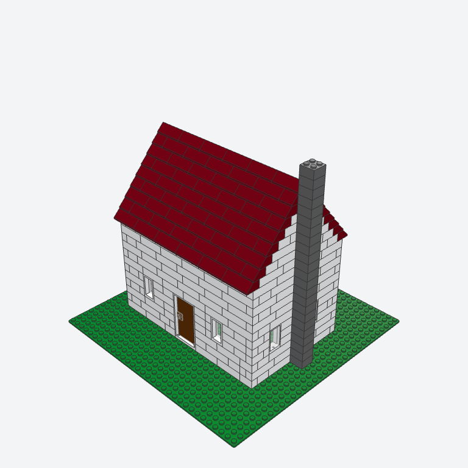

# Live eval: Rung 1: Cottage (2026-10-26)

Run by `emmet eval --rung 1` (plan section 16.1, D-38): one run per agent on the eval API keys, headless, with questions answered from the rung's script in docs/spec/ladder.md.

**Prompt:** Build a small cottage on a green 32 × 32 baseplate: four walls with a door and some windows, a sloped roof, and an optional chimney. Give me sliders for the width, the depth, the wall height, the wall color, the roof color, and whether it has a chimney.

**Features:** a 32 × 32 green baseplate (3811); four closed walls; at least one door and one window from official door and window parts; a sloped roof that covers the walls; a chimney when the chimney parameter is on.

<!-- eval:claude -->
## Claude Code — fail

Claude Code 2.1.310, model claude-opus-5-5, billed to API key. Emmet 0.1.0.

| Score | Required | Result | Detail |
|---|---|---|---|
| Runs and validates with 0 errors | yes | pass | 443 parts, 0 findings (0 errors) |
| Size and features | yes | pass | 443 parts (≥ 40); door yes; windows yes; sloped roof yes; green 32 x 32 baseplate yes |
| Parameters | yes | pass | 3 change the model (≥ 3): wall_color = "Blue", roof_color = "Blue", chimney = false; no change: width, depth, wall_height |
| Availability | no | pass | n/a: color availability arrives with the parts data pack (3B) |
| Budget | yes | fail | 3 min 0 s (≤ 10 min), 41 turns (≤ 40), ended: stopped (over budget) |

Usage: 855504 input and 13651 output tokens (where the CLI reports them; the provider's console has the cost).

Questions: none.

The agent's last message: none (the eval stopped it mid-call).

**What happened (1D, added by hand).** Claude built the cottage in stages, each run, validated, and rendered, and had
a clean 176-part default model with a door, windows, roof, and chimney by tool call 34. It then checked the sliders'
extremes on its own: `run_model` with test values, then `validate`, which rebuilt with params.json and dropped them, so
it wrote params.json from the shell instead (4 calls), and the eval stopped it at call 41, one over the budget. The run
left params.json at the largest values (width 24, depth 16, wall height 12), which is the model scored and rendered
above.

**Scoring correction.** The Parameters line above is the harness's first scoring, which varied each parameter from its
default; with params.json left at the maximums, width, depth, and wall height "didn't change". Varied from the values
the run left (the fixed scoring), all six change the model: width 24 → 10 (443 → 309 parts), depth 16 → 8, wall
height 12 → 7, the two colors, and the chimney (443 → 420). So this run failed on its turn budget only.

**The fix before the one rerun (D-38).** `validate` takes `params` (it runs the model with them and leaves params.json
alone), the doctrine says never to write params.json and to keep a first version to about 30 tool calls, and the eval
varies parameters from their current values. The transcript (2.7 MB scrubbed) is over the 200 KB fixture limit, so it
isn't a replay fixture.

<!-- /eval:claude -->
