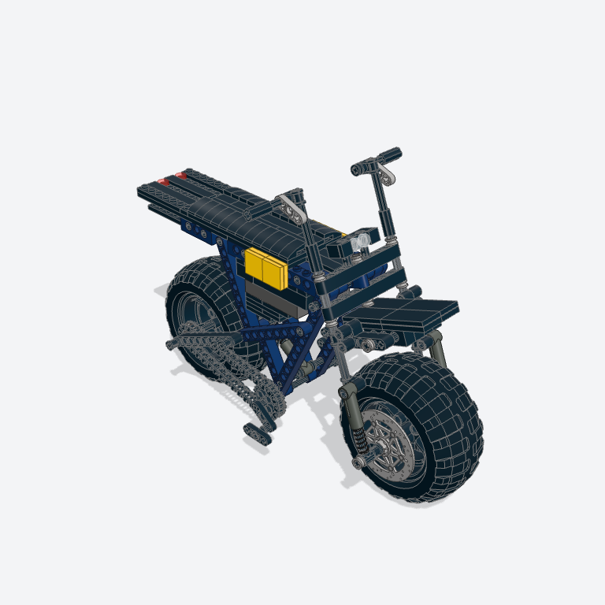

# Live eval: Photo to model (2026-11-11)

Scored by `emmet eval --rung photo` (docs/spec/ladder.md, rung P): from Barry's hand sessions in the app on his plans with `--score`, which sends nothing to an agent (Barry 2026-11-04), or with the fake agents with `--dry-run`. The prompt is "Build this." with a subject's angle a; angle b goes as the next message when the agent asks for another angle. A subject passes at 4 of 6 on the rubric with 0 validator errors and its part count in range; the rung passes for an agent when 3 of the 4 subjects pass. The photos stay on Barry's Mac, so only the renders are here.

<!-- eval:photo-e-bike-claude -->
## Claude Code: e-bike — fail

A modern moto-style electric bicycle (600 to 2000 parts), from Barry's hand session in the app. Claude Code (version unknown), model claude-opus-5-5, billed to Max plan. Emmet 0.1.0.

| Score | Required | Result | Detail |
|---|---|---|---|
| Runs and validates with 0 errors | yes | pass | 268 parts, 0 findings (0 errors) |
| Parts in range | yes | fail | 268 parts (600 to 2000) |
| Built from the photo | yes | pass | the session's first message carried the photo |
| Asked for another angle | no | fail | didn't ask |
| First draft within a minute | no | pass | the first build ran 49 s after the first message (≤ 60 s) |
| Barry's rubric | yes | pass | proportions 2, recognizability 2, buildability 1: 5 of 6 (≥ 4) |

61 turns, 9 min 20 s; 2964248 input and 51265 output tokens where the CLI reports them.

Questions: none.

The agent's last message:

> I built it as a display-scale fat-tire scrambler e-bike, measured from your side photo using the wheel as the ruler. It has a dark blue frame, black seat, rack, fork and bars, silver brake discs, and a yellow badge where the logo is. It stands on its wheels and kickstand with no base.
> 
> It's about 35 studs long and 25 studs to the top of the bars, with 268 parts, and the model check passes with no problems. There are no adjustable settings yet. The rear suspension springs and the fork turns with the bars. I made one compromise: the frame couldn't fit its shock with the crank where it is in the photo, so the crank sits about a stud lower and the front end about 2 studs taller.
> 
> It isn't finished to store-set level yet. The battery is a stepped block instead of the photo's square box with an angled front, and the space under it is still open with a diagonal brace showing. The cables, the black fender close over the front of the rear tire, and the battery lock are also missing. Next, I'd suggest closing in the battery sides with panels and adding those details.
<!-- /eval:photo-e-bike-claude -->

**Barry's notes and what changed after this run** (2026-11-10, Barry's day; the report's date is UTC). Barry scored it
2, 2, 1: "several of the parts are built out of order, you would need to take apart something to add the next step."
This report was scored before two changes that day, so it's kept as it was scored:

- The part count stopped gating a subject (docs/decisions.md, "Report, don't gate"): the "Parts in range" line is now a
  reference, and this run passes the photo rung's bar, 0 errors and 5 of 6. It meets 4G's Done when 4.
- The out-of-order steps were the bike techniques': the brake discs, the rear sprocket, and the front fender's brackets
  went onto axles and fork tubes after both their ends were closed. step_order now warns of that, the techniques put
  those parts on with their axles, and `disc_brake` folded into `suspension_fork` and `swingarm_shock`. This model
  calls `disc_brake`, so on the branch after that change it no longer runs as it was written.
