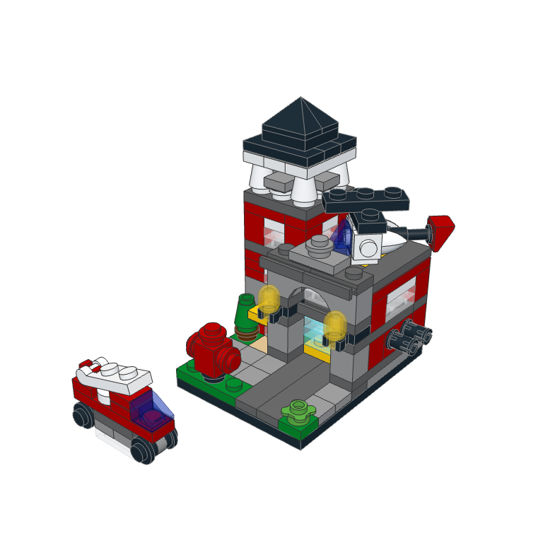
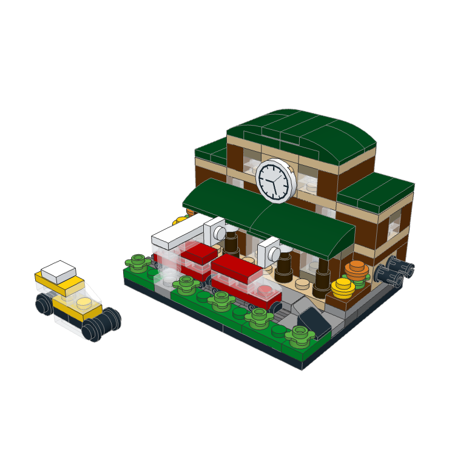
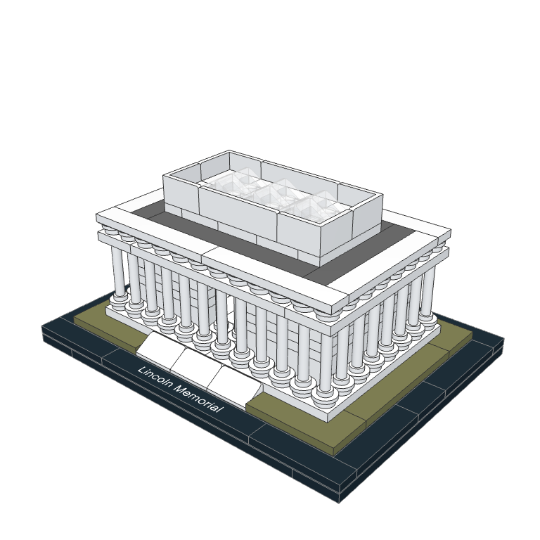
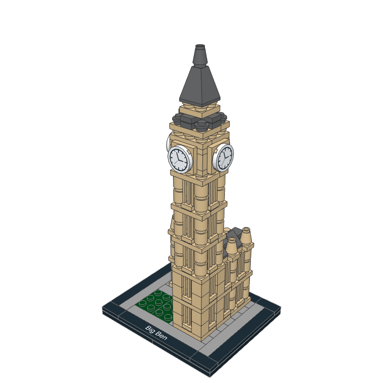
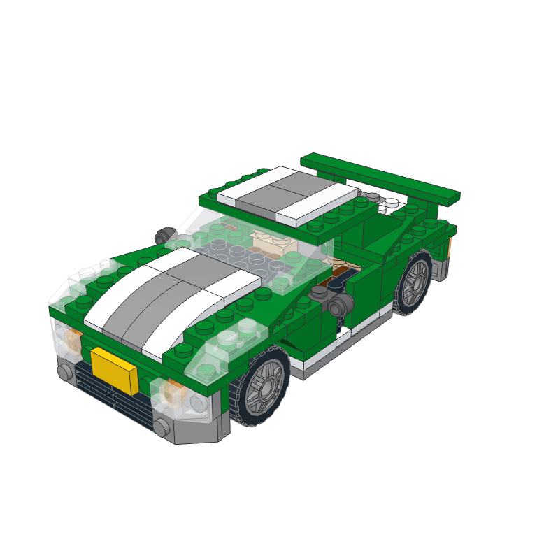

# The model ladder

The test cases everything is measured against (plan section 02, D-11), and how the live eval scores them (section
16.1). `emmet eval` (1D, 5A) reads this file: the prompt each agent gets, the features a run must show, the scoring
config, and the answer script `emmet eval` uses to answer the agent's `ask_user` questions in a headless run.

Rules for every rung:

- Official LDraw parts only (library release 2026-09 or the release Emmet pins later), in colors those parts were
  produced in. Rebrickable's elements table is the source for "produced in" (section 12).
- A rung passes for an agent when its one run passes every required score. A failed run gets at most one rerun,
  after a fix (D-38).
- Questions count toward the turn budget. The eval report lists each question with the answer it got.

## How answer scripts work

When the agent calls `ask_user`, `emmet eval` matches the question against the rung's script, in order: the first
entry whose words all appear in the question (or in one of its options), case-insensitively, gives the answer. If the
answer names one of the options, that option is chosen; otherwise it's sent as the "Other" text. A question no entry
matches gets the agent's recommended option (the first one). On the photo rung, asking for another view, angle, or
photo gets the subject's second photo.

## Rung 1: Cottage

**Prompt** (exact text):

> Build a small cottage on a green 32 × 32 baseplate: four walls with a door and some windows, a sloped roof, and an
> optional chimney. Give me sliders for the width, the depth, the wall height, the wall color, the roof color, and
> whether it has a chimney.

**Features:** a 32 × 32 green baseplate (3811); four closed walls; at least one door and one window from official
door and window parts; a sloped roof that covers the walls; a chimney when the chimney parameter is on.

**Answer script:**

| When the question mentions | Answer |
|---|---|
| style | Classic: tan walls and a dark red roof |
| size, footprint, how big | 8 studs wide and 6 deep |
| roof | A simple gable roof from 45° slopes |
| windows, how many | Two windows on the front, one on each side |
| chimney | Yes, on the right side of the roof |
| color | Tan walls, dark red roof |

## Rung 2: Train station with a track loop

**Prompt** (exact text):

> Build a small train station next to a loop of track, all on green baseplates: a platform whose length I can change,
> a canopy over it, a couple of benches, and a ticket booth. The track loop uses the standard straight and curved
> train track and has one switch with a short siding. Give me sliders for the platform length, the canopy style, the
> loop size, the station colors, and whether the switch and siding are there.

**Features:** a closed loop of plastic train track (straight 53401, curve 53400) whose connectors meet end to end;
one switch from the library's 9V switch points (75541 or 75542, in their straight `-f1` or branching `-f2` form; the
2026-09 library has no plastic switch, and 9V points connect to plastic track); a platform beside the track; a canopy;
benches; a ticket booth; at least 250 parts.

**Answer script:**

| When the question mentions | Answer |
|---|---|
| loop, size, oval, circle | An oval: 4 straights on each long side |
| platform, length | 16 studs long by default |
| canopy | A flat canopy on columns, dark green roof |
| colors, color | Tan and dark red station, dark bluish gray platform |
| switch, siding | Yes: a left switch with a 3-straight siding |
| baseplate | Green 32 × 32 baseplates, as many as the loop needs |

## Rung P: Photo to model

Three subjects Barry photographs himself, two angles each (H-23): two brick models and one real building, no people.
The photos live in `data/ladder/photo/` once H-23 is done (4D).

**Prompt** (exact text, with the subject's first photo attached):

> Build this.

**Features:** a model that reads as the subject at a glance, from real parts, in proportions measured in studs.

**Scoring:** per subject, Barry scores proportions, recognizability, and buildability from 0 to 2 each with the photo
beside the render. A subject passes at 4 of 6 or more with 0 validator errors; the rung passes when 2 of the 3 pass.

**Answer script:**

| When the question mentions | Answer |
|---|---|
| another, angle, view, second photo, side, back | (the subject's second photo) |
| scale, size, how big | Minifigure scale |
| colors, color | Match the photo as closely as real part colors allow |
| detail | Medium detail: the main shapes and colors, not every small part |

## Rung 3: Official set rebuild

One set from the LDraw Official Model Repository (OMR), chosen by Barry (H-11). The agent gets the set's name, its
piece count, and the description below, never the OMR file.

**Prompt** (exact text, with the chosen set's values):

> Rebuild the official set {set_num} "{name}" ({pieces} pieces) as closely as you can, using the same parts and
> colors as the original. Here's what it looks like: {description}

**Ground truth:** the set's Rebrickable inventory for the BOM (from the pinned archive; `tests/fixtures/rebrickable-
mini/` holds the shortlist's), and the OMR model for placements.

**Answer script:**

| When the question mentions | Answer |
|---|---|
| version, edition, variant | The original version, as described |
| scale, size | The original set's size |
| minifig, figure, vehicle | Include everything the description lists |
| anything else | (the agent's recommended option) |

### The shortlist

Ranked from all 1,470 OMR sets by `tests/spikes/omr/shortlist.mjs`: 150–400 pieces, a Rebrickable inventory, and the
largest share of pieces whose part and color appear together in at least 100 sets ("common"), with printed and
minifig parts counting against a set. Every piece of all five maps to an LDraw part (ADR 0004). Renders are by the
ADR 0005 spike from the OMR files (each CC BY 2.0, by the author listed).

| | Set | Pieces | Inventory lines | Common | Printed | Minifig |
|---|---|---|---|---|---|---|
|  | **40182-1 Bricktober Fire Station** (2014). OMR file by Christian Maglekær. | 175 | 66 | 98% | 0% | 1% |
|  | **40142-1 Bricktober Train Station** (2015). OMR file by Christian Maglekær. | 180 | 58 | 94% | 1% | 4% |
|  | **21022-1 Lincoln Memorial** (2015). OMR file by Damien Roux. | 274 | 36 | 95% | 0% | 0% |
|  | **21013-1 Big Ben** (2012). OMR file by Greg Teft. | 346 | 34 | 97% | 1% | 0% |
|  | **6743-1 Street Speeder** (2009, main model). OMR file by Marc Giraudet. | 165 | 69 | 92% | 0% | 0% |

Descriptions the agent gets:

- **40182-1:** A tiny two-story fire station on a small base: dark red walls with clear windows, a light gray
  arched garage door in front, a dark gray roof with a black pointed top, a hydrant and a plant by the door, and a
  small red fire truck parked beside it.
- **40142-1:** A small train station: reddish brown and tan walls, a dark green curved roof with a white clock face
  on the front, a dark green canopy over a short platform with a red two-car train, flowers along a green strip, and
  a small yellow car beside it.
- **21022-1:** A white neoclassical memorial on a dark base with an olive green lawn: a rectangular hall ringed by
  tall round white columns, a flat white attic on top, wide white steps at the front, and a name plate on the base.
- **21013-1:** A tall tan clock tower on a small square base: a slim stepped tower with vertical ribbing, white clock
  faces near the top on each side, a dark gray pointed spire, a lower tan wing at the back, and a strip of green at
  its foot.
- **6743-1:** A low green sports car with white and gray racing stripes over the hood and roof, a clear windshield
  and side windows, a rear wing, light gray wheels with black tires, and a yellow number plate on the front.

**Pick: 6743-1 Street Speeder (Barry, 2026-10-24, H-11).** It's a 3-in-1 set, and the eval rebuilds its main model:
the OMR file's main model uses all 165 pieces in the same 69 part and color lines as the Rebrickable inventory, so the
inventory is the BOM ground truth as it stands, and `6743-1.mpd`'s main model is the placement ground truth. The prompt
for rung 3 is therefore:

> Rebuild the official set 6743-1 "Street Speeder" (165 pieces) as closely as you can, using the same parts and
> colors as the original. Here's what it looks like: A low green sports car with white and gray racing stripes over
> the hood and roof, a clear windshield and side windows, a rear wing, light gray wheels with black tires, and a
> yellow number plate on the front.

## Scoring config

Thresholds from section 16.1, which sets no time or turn budget for the photo rung (`null` until 5A sets one). 5A tunes
them once, from real runs, and an ADR records the change.

```json
{
  "rungs": {
    "1": {
      "required": { "validator_errors": 0, "min_parts": 40, "features": ["door", "window", "roof"], "min_params_that_change_the_model": 3 },
      "max_color_unavailable": 2,
      "budget": { "minutes": 10, "turns": 40 }
    },
    "2": {
      "required": { "validator_errors": 0, "min_parts": 250, "features": ["track_loop_closes", "platform", "canopy"], "min_params_that_change_the_model": 5, "params_include": ["platform length"] },
      "max_color_unavailable": 2,
      "budget": { "minutes": 30, "turns": 120 }
    },
    "P": {
      "required": { "validator_errors": 0, "subject_score_min": 4, "subjects_passing_min": 2 },
      "scored_by": "Barry: proportions, recognizability, buildability, 0-2 each",
      "budget": null
    },
    "3": {
      "required": { "validator_errors": 0, "bom_f1_min": 0.8, "placement_match_min": 0.6 },
      "bom_f1": "part × color, against the Rebrickable inventory",
      "placement_match": "share of OMR parts with a part of the same id within 1 stud",
      "max_color_unavailable": 2,
      "budget": { "minutes": 45 }
    }
  }
}
```
